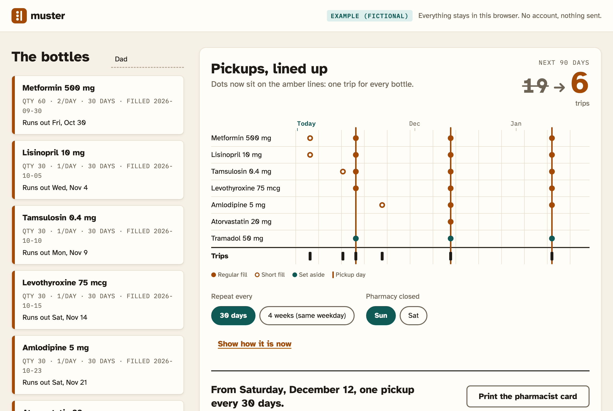
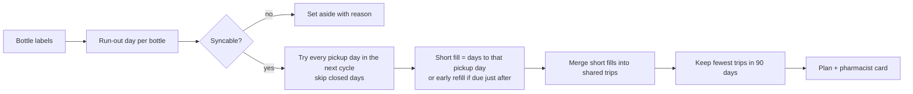

<p align="center">
  
</p>

<h1 align="center">Muster</h1>

<p align="center"><strong>All the bottles. One pickup day.</strong><br>
A medication-synchronization planner for the family member who does the pharmacy runs.</p>

<p align="center">
  <a href="https://hotragn.github.io/muster/app.html?example=1"><strong>Try it live</strong></a> ·
  <a href="#quick-start">Quick start</a> ·
  <a href="#how-it-works">How it works</a> ·
  <a href="docs/ARCHITECTURE.md">Architecture</a> ·
  <a href="docs/METHODOLOGY.md">Methodology</a> ·
  <a href="docs/NEED.md">The need</a> ·
  <a href="video/muster-demo.mp4">Demo video</a>
</p>

<p align="center">
  
</p>

---

## Overview

Someone managing a parent's six or seven daily prescriptions ends up at the pharmacy every few days, and a bottle still runs out on a Saturday night. **Each prescription was filled on a different day, so each runs out on a different day, every month.** Reminder apps tell you when the next bottle is due. They can't make the bottles come due together.

Many pharmacies already offer the fix, **medication synchronization**: one-time short fills that move every prescription onto a single monthly pickup day. The patient usually has to ask, and asking is much easier with the numbers worked out.

Muster works out those numbers. Copy each bottle's label, press **Line them up**, and get:
- the pickup day with the fewest trips, never on a day the pharmacy is closed;
- each one-time short fill, in tablets and days;
- the bottles that shouldn't be synced, and why;
- a one-page card to hand to the pharmacist.

In the fictional example household, **19 pharmacy trips in the next 90 days become 6 (including the changeover), then 1 trip every 30 days instead of 6.**

> Muster plans pickup dates. It never changes a dose, and the pharmacist confirms the plan against the pharmacy record.

## Why it matters

| | |
|---|---|
| **Who** | Family caregivers, often students and young adults, managing a relative's chronic medications; and patients on several long-term prescriptions. |
| **Problem** | Fill dates that start out of step stay out of step: one trip per bottle per cycle, plus missed doses when a bottle runs out between trips. |
| **Insight** | Running out is calendar arithmetic, not a memory problem. The remedy (med sync) exists, but it's hidden behind a conversation most people don't know to start. |
| **Outcome** | Fewer trips, one predictable pickup day, and a ready-made request for the pharmacist. |

Details, workarounds, evidence and its limits: [docs/NEED.md](docs/NEED.md).

## Features

- **Bottle entry from the label:** name, units per day, days' supply, fill date. Optional pill count (overrides the date), form, controlled-substance flag and copay.
- **Before view:** 90-day timeline, one row per bottle, one dot per trip, plus a trip counter.
- **Line them up:** animated alignment of every bottle onto the chosen pickup day.
- **Changeover plan:** trip-by-trip short fills, early refills, and the repeating pickup day.
- **Safety rails:** controlled substances, inhalers, pens, liquids, drops, patches and mismatched supplies are set aside with a reason.
- **Pharmacy calendar:** closed weekdays respected; 30-day or same-weekday 4-week cycle.
- **Copay estimates:** daily-rate proration, labelled as estimates.
- **Pharmacist card:** one printed page with the request sentence, the table of fills and a confirmation note.
- **Private by design:** no account, no network calls, data only in this browser.
- **Accessible:** low-vision typeface, 17 px body, WCAG AA contrast in light and dark, keyboard and screen-reader friendly, reduced-motion support.

## Quick start

Requirements: **Node.js 20+**. No API keys, accounts or services.

```bash
npm install     # dev tooling only (ESLint)
npm start       # http://localhost:4173
```

| Page | URL |
|---|---|
| Landing | http://localhost:4173/ |
| Planner | http://localhost:4173/app.html |
| Planner with the example household (as in the demo) | http://localhost:4173/app.html?example=1&today=2026-10-26 |
| Brand board | http://localhost:4173/brand.html |

**Live demo:** https://hotragn.github.io/muster/ (planner with the example: https://hotragn.github.io/muster/app.html?example=1). It's deployed from `public/` by GitHub Actions (`.github/workflows/pages.yml`) after the unit, contrast and lint checks pass on Node 20. `public/` also works unchanged on any other static host.

## How it works



1. **Run-out day** = fill date + days' supply, or today + pills on hand ÷ pills per day.
2. For each candidate pickup day *A*, a bottle's **short fill** is `(A − run-out) mod cycle` days, so it lands exactly on *A*. A bottle due within a fifth of its supply after a pickup day is **refilled early** on that day instead.
3. Short fills are windows (collectable up to a fifth of the supply early, never after the bottle runs out), **merged into as few trips as possible** with a greedy interval cover.
4. Every trip on a closed weekday moves to the open day before, in both the before and after schedules, so the comparison is fair.
5. The plan with the **fewest trips in 90 days** wins, then the fewest short-fill days, then the earliest full alignment.

Full design, data model, rules table and complexity: [docs/ARCHITECTURE.md](docs/ARCHITECTURE.md).

## Architecture at a glance

| Layer | Implementation |
|---|---|
| Planning core | `public/js/muster.js`: pure functions, integer day arithmetic, no DOM, fully unit-tested |
| UI | `public/js/app.js`: vanilla ES modules, native `<dialog>`, CSS-transition animation, print stylesheet |
| Persistence | `public/js/store.js`: guarded `localStorage` |
| Design system | `public/css/tokens.css`: single token source, contrast-checked by script |
| Server | `server.mjs`: zero-dependency static server with clean URLs |
| Verification | `node:test`, ESLint, headless-Chrome end-to-end checks over the DevTools Protocol |
| Demo pipeline | CDP screencast → ffmpeg, narration by open-source Kokoro-82M |

There are no runtime dependencies and no build step. The whole product is about 1,400 lines of plain JavaScript and CSS.

## Methodology

Insight-first, demo-first, verified by running it:

1. Read the event rules and mapped competing projects to avoid crowded ideas.
2. Studied three candidate users; kept only insights that were true, specific and surprising.
3. Generated 12 ideas through structured lenses, scored them against the judging criteria, and red-teamed the finalists.
4. Wrote the demo script before code; the MVP is what the demo needs.
5. Built the brand before the interface, so every screen uses the same tokens.
6. Built in runnable, committed milestones; froze features once the golden path worked.
7. Verified with unit tests, an end-to-end browser script run three times in a row, a contrast audit, a clean-clone install and a copy audit.

Full write-up, including the domain assumptions and the next validation steps: [docs/METHODOLOGY.md](docs/METHODOLOGY.md).

## Testing and quality

```bash
npm test                          # 15 unit tests for the planning core
npm run contrast                  # 34 WCAG colour pairs, light and dark
npm run lint                      # ESLint
npm run check                     # all of the above
node scripts/golden-path.mjs 3    # needs `npm start`: demo flow ×3 + edge cases in headless Chrome (48 checks)
sh scripts/screenshots.sh         # needs `npm start`: regenerates public/shots/
```

Current status: all unit tests pass, 48/48 end-to-end checks pass, 34/34 contrast pairs pass, lint is clean, and a clean-clone install has been verified.

## Demo video

[`video/muster-demo.mp4`](video/muster-demo.mp4): 1:58, 1080p, captions. A scripted recording of the real app (`scripts/record-demo.mjs`) with narration generated by the open-source **Kokoro-82M** voice model. How to regenerate or re-voice it: [video/README.md](video/README.md).

## Project structure

```text
public/            static site (landing, planner, brand board, fonts, images)
  js/muster.js     planning core (pure)
  js/app.js        planner UI
  css/tokens.css   design tokens
server.mjs         static server
test/              unit tests
scripts/           contrast, end-to-end, screenshots, demo recorder
video/             demo video, narration script, TTS tooling
docs/              need, methodology, architecture, brand, plan, decisions, hackathon records
```

## Limitations

- **Not medical advice.** It plans dates only; doses never change; the pharmacist decides.
- **Manual input.** No pharmacy, insurer or EHR integration.
- **Policy heuristics.** The early-refill allowance (about 80% used) and copay proration vary by plan.
- **One person, one device.** Data lives in one browser's `localStorage`; no reminders.
- **Unvalidated.** Not yet tested with caregivers or pharmacists. The example household is fictional and labelled as such in the app.

## Roadmap

1. Validate the card and the flow with community pharmacists and caregivers.
2. Read bottle labels from a photo, with every field shown for confirmation.
3. Export the pickup day as calendar events.
4. Multiple people per household.

## Documentation

| Document | Contents |
|---|---|
| [docs/NEED.md](docs/NEED.md) | Users, problem, workarounds, evidence, requirements |
| [docs/METHODOLOGY.md](docs/METHODOLOGY.md) | How it was researched, designed, built and verified |
| [docs/ARCHITECTURE.md](docs/ARCHITECTURE.md) | System design, data model, algorithm, verification, privacy, accessibility |
| [docs/BRAND.md](docs/BRAND.md) | Name, concept, colour, type, logo, voice, microcopy |
| [docs/PLAN.md](docs/PLAN.md) | MVP scope, non-goals, milestones |
| [docs/DECISIONS.md](docs/DECISIONS.md) | Decision log |
| [docs/PROGRESS.md](docs/PROGRESS.md) | Timeline, challenges and lessons |
| [docs/IDEAS.md](docs/IDEAS.md) | Insights, ideas, scoring, red team |
| [docs/DEMO.md](docs/DEMO.md) · [docs/PITCH.md](docs/PITCH.md) · [docs/SUBMISSION.md](docs/SUBMISSION.md) | Demo script, pitch, Devpost text |
| [docs/HACKATHON.md](docs/HACKATHON.md) · [docs/LANDSCAPE.md](docs/LANDSCAPE.md) | Event rules and landscape research (NextSpark Hacks 2026) |
| [docs/AI_USAGE.md](docs/AI_USAGE.md) | AI assistance disclosure |

## Credits

- **Atkinson Hyperlegible**, Braille Institute of America, SIL Open Font License 1.1 ([licence](public/fonts/atkinson/OFL.txt))
- **IBM Plex Mono**, IBM Corp., SIL Open Font License 1.1 ([licence](public/fonts/plexmono/OFL.txt))
- **Kokoro-82M** (hexgrad, Apache-2.0) and **kokoro-onnx** (thewh1teagle, MIT): demo narration only, not part of the app
- **ESLint** (MIT); **ffmpeg** and **Google Chrome** (headless) for tooling
- Domain references: American Pharmacists Association, Appointment-Based Model; McKesson, "Med Sync 101"; 42 CFR 423.153(b)(4)
- Logo, illustrations, colours and code are original to this project.

**AI assistance:** built with Claude Code (Anthropic); see [docs/AI_USAGE.md](docs/AI_USAGE.md). The product itself uses no AI; every number is computed deterministically in the browser.

## License

Code: [MIT](LICENSE). Fonts keep their own SIL OFL 1.1 licences.

Built for NextSpark Hacks 2026.
