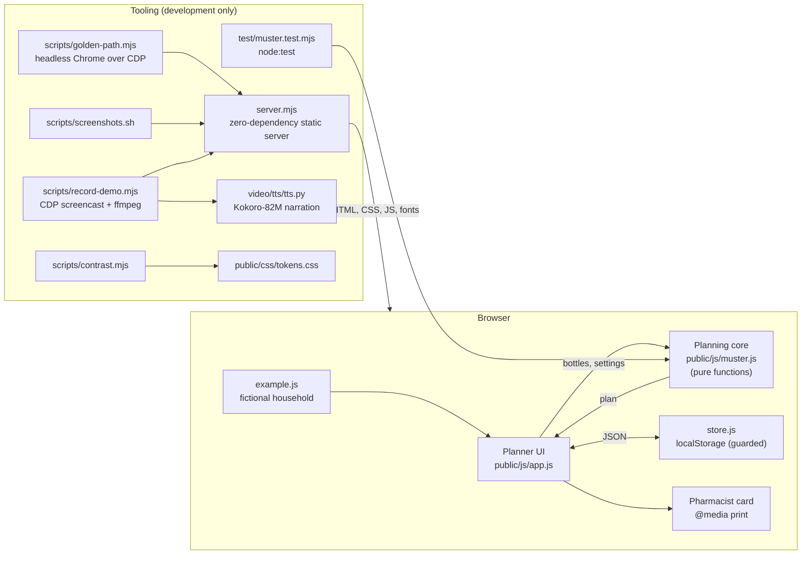
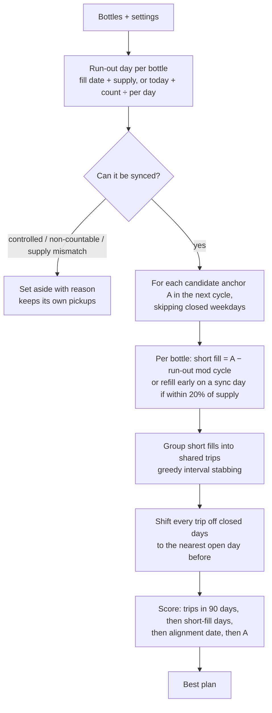

# Architecture

Muster is a static, client-only web application. There is no backend, database, account system or network call at runtime: the planner runs entirely in the browser, and the household's data stays in that browser's `localStorage`. The repository also contains the tooling used to verify it and to produce its screenshots and demo video.

## System overview



## Repository layout

| Path | Role |
|---|---|
| `public/` | Everything that is served. Deployable as-is to any static host. |
| `public/index.html` · `css/landing.css` | Landing page. |
| `public/app.html` · `css/app.css` · `js/app.js` | The planner: bottle list, timeline, result, editor dialog, print card. |
| `public/js/muster.js` | **Planning core.** Pure functions, no DOM; imported by both the browser and the tests. |
| `public/js/example.js` | Fictional example household, with dates relative to "today". |
| `public/js/store.js` | `localStorage` load/save/clear, every access wrapped in `try/catch`. |
| `public/js/theme.js` | `?theme=light|dark` override (screenshots); otherwise the OS decides. |
| `public/brand.html` · `css/brand.css` · `js/brand.js` | Brand board with live contrast ratios computed from the tokens. |
| `public/css/tokens.css` | **Single source of design tokens** (colour light/dark, type, spacing, radii, shadows, motion). |
| `public/css/base.css` | Reset, typography, buttons, focus, the muster-line divider. |
| `public/fonts/` | Vendored OFL fonts and their licences. |
| `public/brand/`, `favicon*`, `apple-touch-icon.png` | Logo, favicons, social card. |
| `public/shots/` | Real screenshots (generated). |
| `server.mjs` | Static server with clean URLs and path-traversal protection. |
| `test/` | Unit tests for the planning core. |
| `scripts/` | Contrast checker, end-to-end check, screenshot capture, demo recorder. |
| `video/` | Narration tooling (`tts/`) and the recorded demo. |
| `brand-src/` | Source for the social card. |
| `docs/` | Need, methodology, architecture, brand, plan, decisions, hackathon records. |

## The planning core (`public/js/muster.js`)

All dates enter and leave as ISO strings (`YYYY-MM-DD`) and are converted to **integer UTC day numbers** internally, so there are no time-zone or daylight-saving errors in the arithmetic.

### Data model

```text
Med {
  id, name,
  kind: 'tablet' | 'capsule' | 'inhaler' | 'insulin' | 'liquid' | 'patch' | 'drops',
  perDay: number,           // units per day (0.25 steps)
  daysSupply: integer,      // 1–120
  lastFill: 'YYYY-MM-DD',
  onHand: number | null,    // optional pill count; overrides the label date
  controlled: boolean,
  copay: number | null      // per fill, optional
}

Plan (ok) {
  today, cycle, horizon, closed[],
  anchor,                   // first sync date chosen
  syncDay, syncTrip,        // date all bottles are aligned, and the trip for it (after closed-day shift)
  syncDays[],               // repeating sync dates within the horizon
  fills[]: { medId, action: 'short'|'early'|'aligned', date, pickup, days, units,
             copayEst, earlyBy, alignedOn, alignedTrip, supply, supplyChanged },
  setAside[]: { medId, reason: 'controlled'|'not-countable'|'supply-mismatch', pickups[] },
  before[], after[],        // distinct trip days in the horizon
  monthBefore, monthAfter,  // trips in one cycle: as-is vs once aligned
  shortDays
}
```

### Algorithm



Key rules and why:

| Rule | Implementation | Why |
|---|---|---|
| Run-out day | `runOutDay`: count beats label; overdue clamps to today | A pill count is more accurate than the label once doses are missed or changed. |
| Short fill length | `(A − R) mod cycle` | Lands the bottle exactly on a sync date. |
| Early refill | if a bottle is due ≤ ⌊0.2 × supply⌋ days after a sync date, refill it on that date | Many plans permit a refill once about 80% of a supply is used; avoids a near-full-cycle short fill. |
| Grouping short fills | each short fill is an interval `[R − ⌊0.2 × supply⌋, R]`; greedy cover by right endpoint, reusing days already on the calendar | Never collected after the bottle runs out; minimises changeover trips. Greedy-by-right-endpoint is optimal for plain interval stabbing; reusing days already on the calendar first keeps it near-optimal here. |
| Cycle supply | `cycleSupply`: supplies that are multiples of the cycle are kept; within 10% they snap (30 → 28, 90 → 84) | Lets 30-day bottles join a 4-week (same-weekday) cycle. |
| Closed days | `openOnOrBefore` applied to every trip, before and after | Keeps the comparison fair and never schedules a trip on a closed day. |
| Set aside | controlled, non-countable forms, supplies that won't fit | These usually cannot be short-filled by tablet count; the pharmacist decides. |
| Units | `ceil(days × perDay)` | Half-tablet doses round up, never down. |
| Copay estimate | `copay ÷ supply × days` | Daily cost-sharing (required for Medicare Part D solid oral doses, 42 CFR 423.153(b)(4)). |

**Complexity.** For *n* bottles, cycle *C* (≤ 30) and horizon *H* (90 days): *O(C · n · (H / supply + log n))*. That's microseconds for any real household, so the plan recomputes instantly on every change, with no debouncing or workers.

### Pure-function boundary
`muster.js` never touches the DOM, storage or the clock. `today` is a parameter (default: the local date). That makes every behaviour testable with fixed dates, and lets the demo pin `?today=2026-10-26` for reproducible numbers.

## The planner UI (`public/js/app.js`)

- **State:** `{ meds, settings: { cycle, closed[], whose }, isExample }`, persisted after every change. `view` is `'before' | 'after'`.
- **Render cycle:** `update()` → `computePlan()` → render bottles, timeline, counter, result, card. No virtual DOM; the screen is small and fully re-rendered with a tiny `el()` helper. Text always goes through `textContent`, never `innerHTML` with user data.
- **Timeline animation (the signature element):** each dot carries both positions as CSS custom properties (`--b`/`--a`, plus opacities). Toggling `.is-after` on the container moves every dot with a 700 ms CSS transition. Pairing is by index per bottle; extra dots fade in or out. `prefers-reduced-motion` sets all durations to zero.
- **Counter:** animated with `requestAnimationFrame`, ease-out cubic; instant under reduced motion. `aria-live="polite"` announces changes.
- **Editor:** native `<dialog>` with `showModal()` (focus trap and Escape for free), inline validation from `validateMed`, focus moved to the first invalid field.
- **Print card:** built in the DOM, hidden on screen and shown only by `@media print`. `?card=1` shows the same card on screen as a preview.
- **URL parameters:** `example=1`, `today=YYYY-MM-DD`, `after=1`, `card=1`, `edit=<id>`, `theme=light|dark`. They exist for the demo, screenshots and tests.

## Design system

`tokens.css` defines every colour (light and dark, with `prefers-color-scheme` and an explicit `data-theme` override), the type scale (17 px body), spacing (4 px base), radii, shadows and motion. Components use only these variables. `scripts/contrast.mjs` parses the token file and checks 17 foreground/background pairs in both modes against WCAG AA (4.5:1 text, 3:1 UI). The brand board recomputes the same ratios live in the browser.

## Server (`server.mjs`)

Node's `http` module and nothing else. It resolves `/app` → `app.html` (a page wins over a folder of the same name), serves `index.html` for directories, sends `Cache-Control: no-cache`, refuses paths outside `public/`, and serves `404.html` otherwise. All links in the pages use explicit `.html`, so `public/` also works unchanged on GitHub Pages, Netlify or any static host.

## Verification architecture

| Layer | Tool | What it proves |
|---|---|---|
| Unit | `node --test test/*.test.mjs` (15 tests) | Date math, run-out rules, set-aside rules, short-fill landing, early refill, grouping within the window, closed days never used, 28-day weekday stability, copay proration, steady-state monthly count, validation. |
| Design | `scripts/contrast.mjs` | 34 colour pairs meet WCAG AA in light and dark. |
| Static | ESLint (recommended rules) | No unused or undefined identifiers, browser/Node globals separated. |
| End to end | `scripts/golden-path.mjs` (headless Chrome over the DevTools Protocol) | The demo flow ×N plus edge cases: empty state, invalid input, one bottle, all days closed, 375 px without horizontal scroll on all pages, 404, images load, zero console errors. |
| Visual | `scripts/screenshots.sh` | Reproducible real screenshots in light mode. |

## Demo video pipeline (`scripts/record-demo.mjs`)

1. Narration lines are synthesised per scene with **Kokoro-82M** (`video/tts/tts.py`, via kokoro-onnx), or macOS `say` as a fallback.
2. Headless Chrome loads the real app at 1440×810 CSS px with a 4/3 device scale (1920×1080 frames). `Page.startScreencast` streams timestamped JPEG frames.
3. Each scene runs its actions on the real page, then holds until its narration clip has finished. A viewer layer (cursor, click ring, captions, title/end cards) is injected for the recording only; it moves into an open `<dialog>` so it stays above the browser's top layer.
4. ffmpeg turns the variable-rate frames into 30 fps H.264 using the frame timestamps, places each narration clip at its scene's start with `adelay`, mixes them, and normalises loudness to −16 LUFS.

## Security and privacy

- No network requests at runtime; no analytics, cookies or third-party scripts. Fonts are vendored.
- Personal health data never leaves the device; storage is `localStorage` on the user's own origin and can be cleared with **Start over**.
- No `innerHTML` with user input; the server refuses path traversal.
- No secrets in the repository; `.env.example` documents the only optional variable (`PORT`).

## Accessibility

Semantic landmarks and headings, skip link, visible 3 px focus rings, native dialog and form controls with labels, inline errors tied with `aria-describedby`, `aria-live` for the trip counter and messages, 44 px minimum targets, reduced-motion support, AA contrast in both themes, and a typeface designed for low-vision readers (Atkinson Hyperlegible) with a 17 px body size.

## Known architectural limits

- **Single device, single person:** `localStorage` only; no sync or sharing.
- **No integrations:** pharmacy, insurer and EHR data are typed by hand.
- **Heuristic policy constants:** the 20% early-refill window and the 10% supply snap are policy assumptions in code, not configuration.
- **Ninety-day horizon:** trips are counted over 90 days; very long supplies (120 days) are only partly visible.
